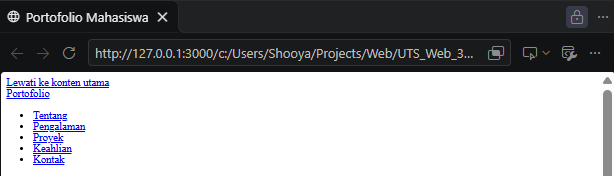
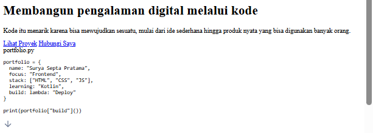
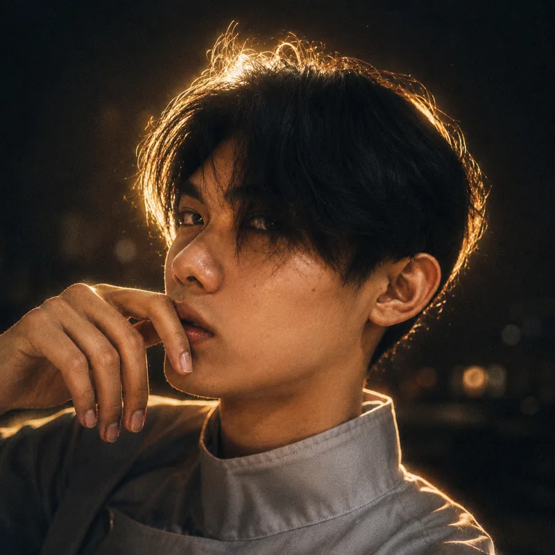
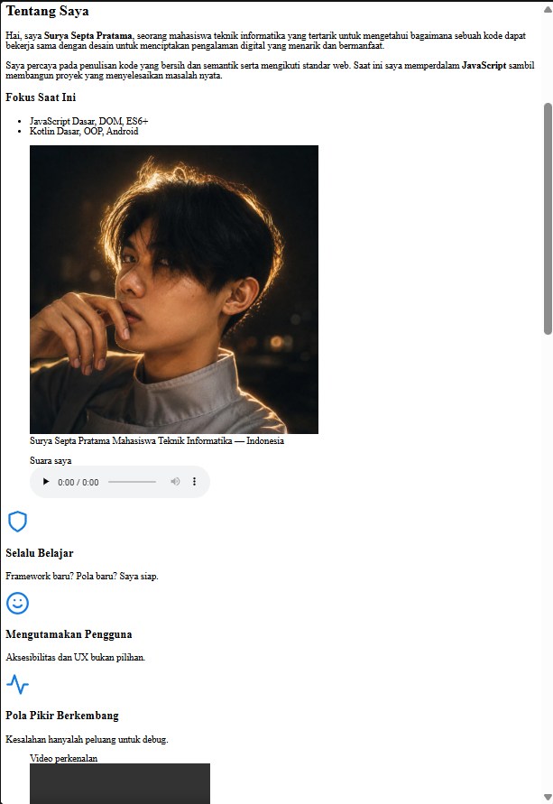
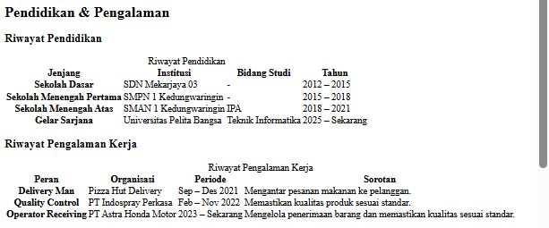
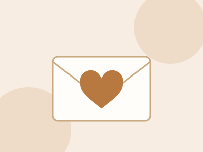
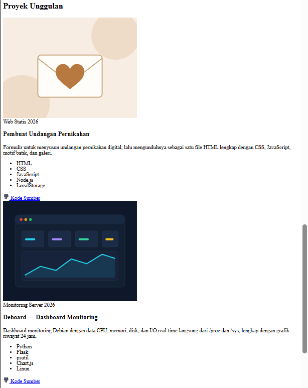
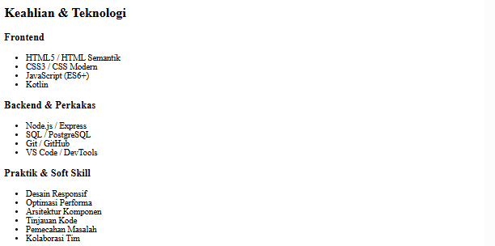
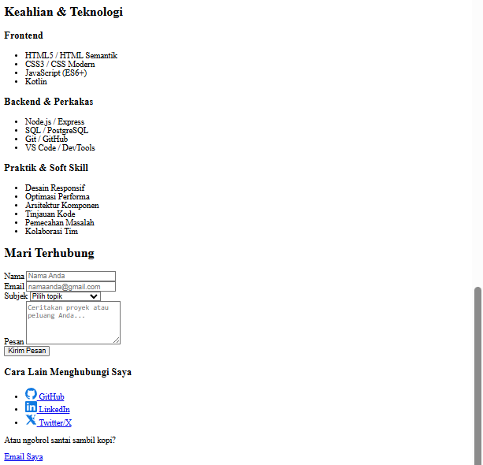
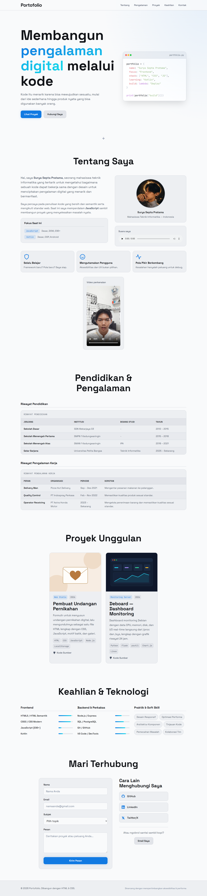

# UTS Pemrograman Web — Website Portofolio

## Struktur Folder

```
UTS_Web_312510124_SuryaSeptaPratama/
├── index.html          # struktur halaman
├── styles.css          # seluruh styling
├── images/
│   ├── profile.webp    # foto profil
│   ├── icon-*.svg      # ikon (activity, chevron, github, linkedin, shield, smile, twitter)
│   └── project-*.svg   # ilustrasi kartu proyek (wedding, deboard)
├── media/
│   ├── audio.mp3       # rekaman suara perkenalan
│   └── video.mp4       # video perkenalan
└── screenshots/        # tangkapan layar (dipakai di dokumen ini)
```

---

## Langkah 1 — Menyiapkan Folder dan Aset

1. Buat folder proyek, lalu buat dua file utama: `index.html` dan `styles.css`.
2. Buat folder `images/` dan `media/`.
3. Siapkan aset:
   - Foto profil (`profile.webp`, 800×800 px, format WebP agar ukuran file kecil).
   - Ikon dan ilustrasi proyek dalam format **SVG** supaya tajam di semua ukuran layar dan ringan.
   - Audio (`audio.mp3`) dan video (`video.mp4`) perkenalan diri.


---

## Langkah 2 — Kerangka Dasar HTML

Pada `index.html` saya menulis kerangka dokumen dengan elemen-elemen penting:

- `<!DOCTYPE html>` dan `<html lang="id">` karena konten berbahasa Indonesia.
- `<meta charset="UTF-8">` dan `<meta name="viewport">` agar tampilan responsif di perangkat mobile.
- `<meta name="description">` dan `<title>` untuk identitas halaman.
- Font **Space Grotesk** dan **JetBrains Mono** dari Google Fonts, lalu `<link rel="stylesheet" href="styles.css">` untuk menghubungkan CSS eksternal.

**index.html — head dan penutup dokumen**

```html
<!DOCTYPE html>
<html lang="id">
<head>
  <meta charset="UTF-8">
  <meta name="viewport" content="width=device-width, initial-scale=1.0">
  <meta name="description" content="Portofolio Mahasiswa - Proyek, Keahlian, dan Pengalaman">
  <title>Portofolio Mahasiswa</title>
  <link rel="preconnect" href="https://fonts.googleapis.com">
  <link rel="preconnect" href="https://fonts.gstatic.com" crossorigin>
  <link href="https://fonts.googleapis.com/css2?family=Space+Grotesk:wght@400;500;600;700&family=JetBrains+Mono:wght@400;500&display=swap" rel="stylesheet">
  <link rel="stylesheet" href="styles.css">
</head>
<body>
  <a href="#main" class="skip-link">Lewati ke konten utama</a>

<!-- ... -->

<footer class="footer" role="contentinfo">
  <div class="container">
    <div class="footer-content">
      <p class="copyright">&copy; 2026 Portofolio. Dibangun dengan HTML & CSS.</p>
      
      <p class="footer-note">Dirancang dengan mempertimbangkan aksesibilitas & performa</p>
    </div>
  </div>
</footer>

</body>
```

---

## Langkah 3 — Menyusun Struktur dengan HTML Semantik

Halaman dibagi memakai elemen semantik, bukan `<div>` saja:

| Elemen | Fungsi |
|---|---|
| `<header>` + `<nav>` | Navigasi utama dengan tautan ke tiap bagian |
| `<main>` | Isi utama halaman |
| `<section>` | Hero, Tentang, Pengalaman, Proyek, Keahlian, Kontak |
| `<article>` | Kartu proyek |
| `<figure>` + `<figcaption>` | Foto profil, audio, dan video |
| `<footer>` | Hak cipta dan catatan penutup |

Setiap `<section>` diberi `id` (`about`, `experience`, `projects`, `skills`, `contact`) sehingga menu navigasi bisa melompat ke bagian terkait dengan tautan anchor (`href="#about"`, dst.).

Aksesibilitas yang ditambahkan: tautan **"Lewati ke konten utama"** (`skip-link`), atribut `aria-label` dan `aria-labelledby`, `alt` pada gambar, serta `alt=""` pada gambar dekoratif.

**index.html — skip-link, header/nav, dan pembuka section**

```html
<a href="#main" class="skip-link">Lewati ke konten utama</a>

<header class="header" role="banner">
  <nav class="nav container" aria-label="Navigasi utama">
    <a href="#" class="logo" aria-label="Beranda">Portofolio</a>
    <ul id="nav-menu" class="nav-menu" role="list">
      <li><a href="#about" class="nav-link">Tentang</a></li>
      <li><a href="#experience" class="nav-link">Pengalaman</a></li>
      <li><a href="#projects" class="nav-link">Proyek</a></li>
      <li><a href="#skills" class="nav-link">Keahlian</a></li>
      <li><a href="#contact" class="nav-link">Kontak</a></li>
    </ul>
  </nav>
</header>

<!-- ... -->

<section id="about" class="section about" aria-labelledby="about-title">
  <div class="container">
    <header class="section-header">
      <h2 id="about-title" class="section-title">Tentang Saya</h2>
    </header>
```



---

## Langkah 4 — Mengisi Konten Tiap Bagian

### 4.1 Hero
Judul "Membangun pengalaman digital melalui kode", deskripsi singkat, dua tombol (**Lihat Proyek** dan **Hubungi Saya**), dan jendela kode bergaya editor (`portfolio.py`) berisi ringkasan diri.

```html
<section class="hero" aria-labelledby="hero-title">
  <div class="container hero-grid">
    <div class="hero-content">
      <h1 id="hero-title" class="hero-title">
        Membangun <span class="highlight">pengalaman digital</span> melalui kode
      </h1>
      <p class="hero-description">
        Kode itu menarik karena bisa mewujudkan sesuatu, mulai dari ide 
        sederhana hingga produk nyata yang bisa digunakan banyak orang.
      </p>
      <div class="hero-actions">
        <a href="#projects" class="btn btn-primary">Lihat Proyek</a>
        <a href="#contact" class="btn btn-secondary">Hubungi Saya</a>
      </div>
    </div>
    <div class="hero-visual" aria-hidden="true">
      <div class="code-window">
        <div class="code-header">
          <div class="code-dots">
            <span></span><span></span><span></span>
          </div>
          <span class="code-filename">portfolio.py</span>
        </div>
        <pre class="code-content"><code>portfolio = <span class="op">{</span>
<span class="prop">name</span>: <span class="str">"Surya Septa Pratama"</span>,
<span class="prop">focus</span>: <span class="str">"Frontend"</span>,
<span class="prop">stack</span>: <span class="op">[</span><span class="str">"HTML"</span>, <span class="str">"CSS"</span>, <span class="str">"JS"</span><span class="op">]</span>,
<span class="prop">learning</span>: <span class="str">"Kotlin"</span>,
<span class="prop">build</span>: <span class="kw">lambda</span>: <span class="str">"Deploy"</span>
<span class="op">}</span>

<span class="kw">print</span><span class="op">(</span>portfolio<span class="op">[</span><span class="str">"build"</span><span class="op">]())</span></code></pre>
      </div>
    </div>
  </div>
  <div class="scroll-indicator" aria-hidden="true">
    
  </div>
</section>
```



### 4.2 Tentang Saya
Dua paragraf perkenalan, kartu **Fokus Saat Ini** (JavaScript dan Kotlin), foto profil, pemutar **audio** (`<audio controls>`), tiga kartu nilai diri (Selalu Belajar, Mengutamakan Pengguna, Pola Pikir Berkembang), dan pemutar **video** (`<video controls>`).

Audio dan video memakai `preload="none"` agar file tidak diunduh sebelum diputar, sehingga halaman tetap cepat dimuat.

**Tentang Saya (foto, audio, kartu highlight, video)**

```html
<figure class="info-card profile-figure">
  
  <figcaption>
    <span class="profile-name">Surya Septa Pratama</span>
    <span class="profile-role">Mahasiswa Teknik Informatika &mdash; Indonesia</span>
  </figcaption>
</figure>
<figure class="info-card media-block">
  <figcaption>Suara saya</figcaption>
  <audio controls preload="none" src="media/audio.mp3" aria-label="Audio intro demo">
    Your browser does not support audio playback.
  </audio>
</figure>

<!-- ... -->

<div class="about-highlights">
  <div class="highlight-card">
    
    <h3>Selalu Belajar</h3>
    <p>Framework baru? Pola baru? Saya siap.</p>
  </div>
  <div class="highlight-card">
    
    <h3>Mengutamakan Pengguna</h3>
    <p>Aksesibilitas dan UX bukan pilihan.</p>
  </div>
  <div class="highlight-card">
    
    <h3>Pola Pikir Berkembang</h3>
    <p>Kesalahan hanyalah peluang untuk debug.</p>
  </div>
</div>

<!-- ... -->

<figure class="info-card media-block about-video">
  <figcaption>Video perkenalan</figcaption>
  <video controls preload="none" playsinline src="media/video.mp4" aria-label="Video perkenalan">
    Your browser does not support video playback.
  </video>
</figure>
```



### 4.3 Pendidikan & Pengalaman
Dua **tabel**: Riwayat Pendidikan (SD sampai Sarjana) dan Riwayat Pengalaman Kerja. Berikut tabel pertama; tabel kedua strukturnya sama. Tabel memakai `<caption>`, `<thead>`, `<tbody>`, serta `scope="col"` / `scope="row"` supaya terbaca benar oleh screen reader.

**Tabel Riwayat Pendidikan**

```html
<table class="data-table">
  <caption>Riwayat Pendidikan</caption>
  <thead>
    <tr>
      <th scope="col">Jenjang</th>
      <th scope="col">Institusi</th>
      <th scope="col">Bidang Studi</th>
      <th scope="col">Tahun</th>
    </tr>
  </thead>
  <tbody>
    <tr>
      <th scope="row">Sekolah Dasar</th>
      <td>SDN Mekarjaya 03</td>
      <td>-</td>
      <td>2012 &ndash; 2015</td>
    </tr>
    <tr>
      <th scope="row">Sekolah Menengah Pertama</th>
      <td>SMPN 1 Kedungwaringin</td>
      <td>-</td>
      <td>2015 &ndash; 2018</td>
    </tr>
    <tr>
      <th scope="row">Sekolah Menengah Atas</th>
      <td>SMAN 1 Kedungwaringin</td>
      <td>IPA</td>
      <td>2018 &ndash; 2021</td>
    </tr>
    <tr>
      <th scope="row">Gelar Sarjana</th>
      <td>Universitas Pelita Bangsa</td>
      <td>Teknik Informatika</td>
      <td>2025 &ndash; Sekarang</td>
    </tr>
  </tbody>
</table>
```



### 4.4 Proyek Unggulan
Dua kartu proyek:
- **Pembuat Undangan Pernikahan** (HTML, CSS, JavaScript, Node.js, LocalStorage)
- **Deboard — Dashboard Monitoring** (Python, Flask, psutil, Chart.js, Linux)

Masing-masing memiliki tautan ke repositori GitHub (`target="_blank"` dengan `rel="noopener noreferrer"`).

**Kartu proyek**

```html
<article class="project-card" role="listitem">
  <div class="project-image" aria-hidden="true">
    
  </div>
  <div class="project-content">
    <div class="project-meta">
      <span class="project-type">Web Statis</span>
      <span class="project-year">2026</span>
    </div>
    <h3 class="project-title">Pembuat Undangan Pernikahan</h3>
    <p class="project-description">
      Formulir untuk menyusun undangan pernikahan digital, lalu mengunduhnya sebagai
      satu file HTML lengkap dengan CSS, JavaScript, motif batik, dan galeri.
    </p>
    <ul class="project-tech" role="list" aria-label="Teknologi yang digunakan">
      <li>HTML</li>
      <li>CSS</li>
      <li>JavaScript</li>
      <li>Node.js</li>
      <li>LocalStorage</li>
    </ul>
    <div class="project-links">
      <a href="https://github.com/shooya-x/wedding-invitation-maker" class="project-link" target="_blank" rel="noopener noreferrer" aria-label="Lihat kode sumber di GitHub">
        
        Kode Sumber
      </a>
    </div>
  </div>
</article>
```



### 4.5 Keahlian & Teknologi
Tiga kategori: **Frontend**, **Backend & Perkakas**, dan **Praktik & Soft Skill**. Tingkat kemampuan ditampilkan sebagai bar progres. Nilainya dikirim dari HTML lewat custom property CSS, misalnya `style="--level: 90%"`.

**Kategori Frontend pada Keahlian**

```html
<div class="skill-category">
  <h3 class="skill-category-title">Frontend</h3>
  <ul class="skill-list" role="list">
    <li class="skill-item" data-level="90">
      <span class="skill-name">HTML5 / HTML Semantik</span>
      <div class="skill-bar"><span class="skill-progress" style="--level: 90%"></span></div>
    </li>
    <li class="skill-item" data-level="85">
      <span class="skill-name">CSS3 / CSS Modern</span>
      <div class="skill-bar"><span class="skill-progress" style="--level: 85%"></span></div>
    </li>
    <li class="skill-item" data-level="20">
      <span class="skill-name">JavaScript (ES6+)</span>
      <div class="skill-bar"><span class="skill-progress" style="--level: 20%"></span></div>
    </li>
    <li class="skill-item" data-level="30">
      <span class="skill-name">Kotlin</span>
      <div class="skill-bar"><span class="skill-progress" style="--level: 30%"></span></div>
    </li>
  </ul>
</div>
```



### 4.6 Kontak
Formulir (nama, email, subjek berupa `<select>`, pesan) dengan validasi bawaan HTML5 (`required`, `minlength`, `maxlength`, `type="email"`). Aksi formulir memakai `mailto:`. Di sampingnya ada tautan GitHub, LinkedIn, Twitter/X, dan tombol email.

**Formulir kontak**

```html
<form class="contact-form" action="mailto:suryasepta217@gmail.com" method="post" enctype="text/plain" aria-label="Formulir kontak">
  <div class="form-group">
    <label for="name">Nama</label>
    <input type="text" id="name" name="name" required minlength="2" maxlength="60" autocomplete="name" placeholder="Nama Anda">
  </div>
  <div class="form-group">
    <label for="email">Email</label>
    <input type="email" id="email" name="email" required autocomplete="email" placeholder="namaanda@gmail.com">
  </div>
  <div class="form-group">
    <label for="subject">Subjek</label>
    <select id="subject" name="subject" required>
      <option value="">Pilih topik</option>
      <option value="internship">Peluang Magang</option>
      <option value="collaboration">Kolaborasi</option>
      <option value="freelance">Proyek Freelance</option>
      <option value="mentorship">Mentoring / Saran</option>
      <option value="other">Lainnya</option>
    </select>
  </div>
  <div class="form-group">
    <label for="message">Pesan</label>
    <textarea id="message" name="message" rows="5" required minlength="10" maxlength="1000" placeholder="Ceritakan proyek atau peluang Anda..."></textarea>
  </div>
  <button type="submit" class="btn btn-primary btn-full">Kirim Pesan</button>
</form>
```



---

## Langkah 5 — Membangun Design System di CSS

Sebelum menulis gaya komponen, saya mendefinisikan **design token** memakai CSS custom properties dalam **satu blok `:root`**:

- **Warna**: nilai ditulis langsung dalam format HSL. Latar terang (`--color-bg: 220 15% 98%`), teks gelap (`--color-text: 220 15% 8%`), warna utama biru (`--color-primary`), aksen cyan (`--color-accent`), warna fokus, dan warna error untuk keadaan tidak valid pada formulir. Format HSL memudahkan pemberian transparansi, contoh `hsl(var(--color-primary) / 0.1)`.
- **Tipografi**: `--font-sans`, `--font-mono`, ukuran font fluid memakai `clamp()`, dan tinggi baris.
- **Spacing**: skala kelipatan 4px berbasis 8px (`--space-1` dst.).
- **Border radius, shadow, z-index, lebar container, dan tinggi header**.

Karena situs hanya memakai mode terang, tidak ada blok override tema kedua — semua warna final ditulis di blok `:root` yang sama. Perubahan warna atau jarak cukup dilakukan di satu tempat.

**styles.css — design token**

```css
:root {
  /* ---- Warna ---- */
  --color-bg: 220 15% 98%;
  --color-bg-elevated: 0 0% 100%;
  --color-surface: 220 15% 94%;
  --color-surface-2: 220 15% 90%;
  --color-surface-3: 220 15% 86%;
  --color-border: 220 15% 82%;
  --color-border-strong: 220 15% 70%;
  --color-text: 220 15% 8%;
  --color-text-muted: 220 15% 35%;
  --color-text-subtle: 220 15% 50%;
  --color-primary: 210 85% 48%;
  --color-primary-hover: 210 85% 42%;
  --color-accent: 185 85% 50%;
  --color-error: 0 75% 55%;
  --color-focus: 210 85% 48%;

  /* ---- Typography ---- */
  --font-sans: 'Space Grotesk', system-ui, -apple-system, sans-serif;
  --font-mono: 'JetBrains Mono', 'Fira Code', monospace;
  --font-size-fluid-xs: clamp(0.75rem, 0.7rem + 0.25vw, 0.875rem);
  --font-size-fluid-sm: clamp(0.875rem, 0.825rem + 0.25vw, 1rem);
  --font-size-fluid-base: clamp(1rem, 0.925rem + 0.375vw, 1.125rem);
  /* ... */
  /* ---- Spacing Scale ---- */
  --space-0: 0;
  --space-1: 0.25rem;   /* 4px */
  --space-2: 0.5rem;    /* 8px */
  --space-3: 0.75rem;   /* 12px */
  /* ... */
  /* ---- Shadows ---- */
  --shadow-sm: 0 1px 2px 0 rgb(0 0 0 / 0.05);
  --shadow-lg: 0 10px 15px -3px rgb(0 0 0 / 0.07), 0 4px 6px -4px rgb(0 0 0 / 0.07);
  --shadow-glow: 0 0 20px hsl(var(--color-primary) / 0.2);
  /* ... */
}
```

---

## Langkah 6 — Reset, Dasar, dan Komponen Umum

1. **Reset dan gaya dasar**: `box-sizing`, `scroll-behavior`, gaya `body`, heading, tautan, dan `:focus-visible` agar fokus keyboard terlihat jelas.
2. **Komponen yang dipakai ulang**: `.container`, `.section`, `.section-header`, tombol `.btn` (`.btn-primary`, `.btn-secondary`, `.btn-full`), dan `.highlight`.
3. **Header**: `position: fixed` dengan latar semi-transparan dan `backdrop-filter: blur(20px)`, sehingga menu tetap terlihat saat halaman digulir.

**Reset dan gaya dasar**

```css
/* ==========================================================================
   RESET & BASE
   ========================================================================== */

*, *::before, *::after {
  box-sizing: border-box;
  margin: 0;
  padding: 0;
}

html {
  scroll-behavior: auto;
  scroll-padding-top: var(--header-height);
  -webkit-text-size-adjust: 100%;
}


body {
  font-family: var(--font-sans);
  font-size: var(--font-size-fluid-base);
  line-height: var(--line-height-normal);
  color: hsl(var(--color-text));
  background: hsl(var(--color-bg));

  -webkit-font-smoothing: antialiased;
  -moz-osx-font-smoothing: grayscale;
  text-rendering: optimizeLegibility;
}

img, picture, video, canvas, svg {
  display: block;
  max-width: 100%;
  height: auto;
}

a { color: inherit; text-decoration: none; }
button { font: inherit; color: inherit; background: none; border: none; cursor: pointer; }
ul, ol { list-style: none; }

/* Focus visible for accessibility */
:focus:not(:focus-visible) { outline: none; }
:focus-visible {
  outline: 2px solid hsl(var(--color-focus));
  outline-offset: 2px;
  border-radius: var(--radius-sm);
}

.skip-link {
  position: absolute;
  top: -100%;
  left: 50%;
  transform: translateX(-50%);
  padding: var(--space-3) var(--space-6);
  background: hsl(var(--color-primary));
  color: white;
  border-radius: var(--radius-md);
  z-index: var(--z-tooltip);
  font-weight: var(--font-weight-semibold);
}
.skip-link:focus { top: var(--space-4); }

/* Selection */
::selection {
  background: hsl(var(--color-primary) / 0.3);
  color: hsl(var(--color-text));
}
```

**Container, section, dan tombol**

```css
.container {
  width: 100%;
  max-width: var(--container-max);
  margin: 0 auto;
  padding: 0 var(--container-padding);
}

.section {
  padding: var(--space-20) 0;
}

.section-header {
  text-align: center;
  max-width: 700px;
  margin: 0 auto var(--space-16);
}


/* ... */

.btn {
  display: inline-flex;
  align-items: center;
  justify-content: center;
  gap: var(--space-2);
  padding: var(--space-3) var(--space-6);
  font-size: var(--font-size-fluid-sm);
  font-weight: var(--font-weight-semibold);
  border-radius: var(--radius-lg);

  white-space: nowrap;
}

.btn-primary {
  background: hsl(var(--color-primary));
  color: white;
  box-shadow: var(--shadow-glow);
}
.btn-primary:hover { background: hsl(var(--color-primary-hover)); box-shadow: var(--shadow-glow-lg); }
.btn-primary:active { transform: translateY(0); }

.btn-secondary {
  background: hsl(var(--color-surface-2));
  color: hsl(var(--color-text));
  border: 1px solid hsl(var(--color-border));
}
.btn-secondary:hover { background: hsl(var(--color-surface-3)); border-color: hsl(var(--color-border-strong)); }

.btn-full { width: 100%; }
```

**Header tetap di atas**

```css
.header {
  position: fixed;
  top: 0;
  left: 0;
  right: 0;
  height: var(--header-height);
  background: hsl(var(--color-bg) / 0.8);
  backdrop-filter: blur(20px);
  border-bottom: 1px solid hsl(var(--color-border));
  z-index: var(--z-fixed);

}

.nav {
  display: flex;
  align-items: center;
  justify-content: space-between;
  height: 100%;
}

.logo {
  font-size: var(--font-size-fluid-xl);
  font-weight: var(--font-weight-bold);
  color: hsl(var(--color-text));
  letter-spacing: -0.02em;
}
```

---

## Langkah 7 — Styling Per Bagian

| Bagian | Teknik utama |
|---|---|
| Hero | CSS Grid dua kolom, jendela kode dengan pewarnaan sintaks lewat kelas `.kw`, `.str`, `.prop`, `.op` |
| Tentang | Grid dua kolom (teks + kartu "Fokus Saat Ini" di kiri, foto profil dan pemutar audio di kanan), lalu baris kartu highlight dengan `auto-fit` + `minmax()` dan kartu video lebar penuh |
| Pengalaman | `.table-wrap` dengan `overflow-x: auto` agar tabel bisa digeser di layar kecil, `.data-table` dengan garis pemisah antar baris |
| Proyek | Kartu dengan rasio gambar `4/3`, label tipe dan tahun, daftar teknologi berbentuk tag |
| Keahlian | Bar progres: lebar diatur `width: var(--level)` dengan gradasi warna utama ke aksen |
| Kontak | Grid dua kolom, formulir dengan `.form-group`, tautan sosial dalam daftar |
| Footer | Flexbox, rata tengah di mobile dan sejajar kiri-kanan di layar lebar |

**Hero dan jendela kode**

```css
.hero {
  min-height: 100vh;
  display: flex;
  align-items: center;
  padding: calc(var(--header-height) + var(--space-16)) 0 var(--space-20);
  position: relative;
  overflow: hidden;
}

.hero::before {
  content: '';
  position: absolute;
  top: 0;
  right: 0;
  width: 60%;
  height: 100%;
  background: radial-gradient(ellipse at top right, hsl(var(--color-primary) / 0.08), transparent 60%);
  pointer-events: none;
}

.hero-grid {
  display: grid;
  grid-template-columns: 1fr;
  gap: var(--space-12);
  align-items: center;
}

/* ... */

.code-window {
  background: hsl(var(--color-bg-elevated));
  border: 1px solid hsl(var(--color-border));
  border-radius: var(--radius-xl);
  overflow: hidden;
  box-shadow: var(--shadow-2xl);

}

.code-header {
  display: flex;
  align-items: center;
  justify-content: space-between;
  padding: var(--space-3) var(--space-4);
  background: hsl(var(--color-surface));
  border-bottom: 1px solid hsl(var(--color-border));
}
```

**Tentang**

```css
.about-grid {
  display: grid;
  grid-template-columns: 1fr;
  gap: var(--space-8);
}

.about-text { margin-bottom: var(--space-6); }
.about-text:first-of-type { font-size: var(--font-size-fluid-lg); }

.about-highlights { display: grid; grid-template-columns: repeat(auto-fit, minmax(200px, 1fr)); gap: var(--space-4); margin-top: var(--space-8); }

/* ... */

.about-sidebar { display: grid; gap: var(--space-6); }
.info-card {
  background: hsl(var(--color-surface));
  border: 1px solid hsl(var(--color-border));
  border-radius: var(--radius-xl);
  padding: var(--space-6);
}
.info-card h3 { font-size: var(--font-size-fluid-base); margin-bottom: var(--space-4); padding-bottom: var(--space-3); border-bottom: 1px solid hsl(var(--color-border)); }

.media-block { display: flex; flex-direction: column; }
.media-block audio { width: 100%; margin-top: auto; border-radius: var(--radius-md); }
.media-block video {
  display: block;
  width: 100%;
  margin-top: auto;
  aspect-ratio: 16 / 9;
  border-radius: var(--radius-md);
  background: hsl(var(--color-surface-2));
}
.about-video { margin-top: var(--space-8); }
```

**Proyek**

```css
.projects-grid {
  display: grid;
  grid-template-columns: 1fr;
  gap: var(--space-8);
}

.project-card {
  background: hsl(var(--color-surface));
  border: 1px solid hsl(var(--color-border));
  border-radius: var(--radius-xl);
  overflow: hidden;

}
.project-card:hover {
  border-color: hsl(var(--color-primary) / 0.3);
  box-shadow: var(--shadow-xl);
}

.project-image { aspect-ratio: 4/3; overflow: hidden; }
.project-image img { width: 100%; height: 100%; object-fit: cover; }
.project-card:hover .project-image img { }

.project-content { padding: var(--space-6); }
```

**Tabel pengalaman**

```css
.table-wrap {
  overflow-x: auto;
  border: 1px solid hsl(var(--color-border));
  border-radius: var(--radius-xl);
  background: hsl(var(--color-surface));
}
.data-table {
  width: 100%;
  min-width: 640px;
  border-collapse: collapse;
  text-align: left;
  font-size: var(--font-size-fluid-sm);
}
.data-table caption {
  padding: var(--space-4) var(--space-5);
  text-align: left;
  font-size: var(--font-size-fluid-xs);
  font-family: var(--font-mono);
  letter-spacing: 0.05em;
  text-transform: uppercase;
  color: hsl(var(--color-text-muted));
  border-bottom: 1px solid hsl(var(--color-border));
}
.data-table thead th {
  padding: var(--space-3) var(--space-5);
  background: hsl(var(--color-surface-2));
  font-weight: var(--font-weight-semibold);
  font-size: var(--font-size-fluid-xs);
  text-transform: uppercase;
  letter-spacing: 0.05em;
  color: hsl(var(--color-text));
  border-bottom: 1px solid hsl(var(--color-border));
}
.data-table th, .data-table td {
  padding: var(--space-3) var(--space-5);
  vertical-align: top;
}
.data-table tbody th {
  font-weight: var(--font-weight-semibold);
  color: hsl(var(--color-text));
  white-space: nowrap;
}
.data-table tbody td { color: hsl(var(--color-text-muted)); }
.data-table tbody tr + tr th,
.data-table tbody tr + tr td { border-top: 1px solid hsl(var(--color-border)); }
.data-table tbody tr:nth-child(even) { background: hsl(var(--color-surface-2) / 0.4); }
.data-table tbody tr:hover { background: hsl(var(--color-primary) / 0.05); }
```

**Bar keahlian**

```css
.skill-item { display: grid; grid-template-columns: 1fr auto; gap: var(--space-4); align-items: center; }
.skill-name { font-size: var(--font-size-fluid-sm); font-weight: var(--font-weight-medium); }
.skill-bar {
  width: 100px;
  height: 6px;
  background: hsl(var(--color-surface-2));
  border-radius: var(--radius-full);
  overflow: hidden;
}
.skill-progress {
  display: block;
  height: 100%;
  width: var(--level);
  background: linear-gradient(90deg, hsl(var(--color-primary)), hsl(var(--color-accent)));
  border-radius: var(--radius-full);

  --level: 0%;
}
```

**Kontak dan footer**

```css
.contact-grid {
  display: grid;
  grid-template-columns: 1fr;
  gap: var(--space-12);
  max-width: 900px;
  margin: 0 auto;
}

.contact-form { background: hsl(var(--color-surface)); border: 1px solid hsl(var(--color-border)); border-radius: var(--radius-xl); padding: var(--space-8); }

/* ... */

.footer {
  padding: var(--space-10) 0;
  border-top: 1px solid hsl(var(--color-border));
  background: hsl(var(--color-surface));
}
.footer-content { display: flex; flex-direction: column; align-items: center; gap: var(--space-4); text-align: center; }
.copyright { color: hsl(var(--color-text-muted)); font-size: var(--font-size-fluid-sm); }
.footer-note { font-size: var(--font-size-fluid-xs); color: hsl(var(--color-text-subtle)); }
```

